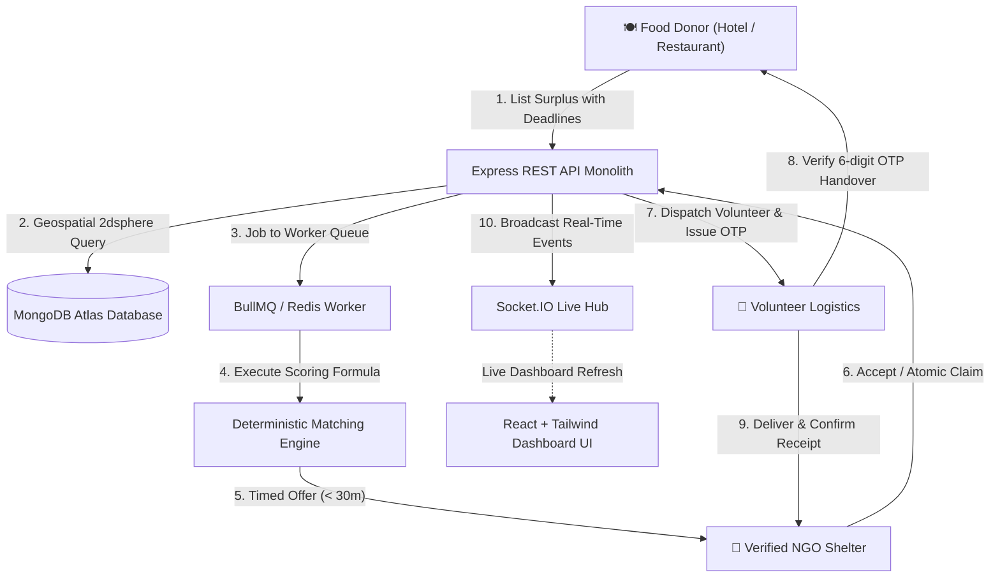

# FoodRescue – Smart Food Waste Reduction & Redistribution Platform

> *"Every surplus meal should have the opportunity to reach someone who needs it before it goes to waste."*

FoodRescue is a production-oriented, full-stack web platform connecting restaurants, hotels, supermarkets, grocery stores, bakeries, and food donors with verified NGOs, charitable kitchens, shelters, and verified individuals.

The system features real-time notifications, strict food safety deadlines, atomic multi-recipient claims, and a **deterministic rule-based allocation engine** with zero AI/ML dependencies.

---

## 1. System Architecture



---

## 2. Deterministic Allocation Formula

The platform strictly avoids black-box AI/LLM models. Every matching decision is 100% deterministic and mathematically reproducible:

$$\text{Final Score} = 0.30 \times \text{Capacity} + 0.25 \times \text{Urgency} + 0.20 \times \text{Transportation} + 0.15 \times \text{Distance} + 0.10 \times \text{Reliability}$$

- **Capacity Suitability (30%)**: Percentage of donation portions the NGO's storage facility can immediately safely accept.
- **Urgency Suitability (25%)**: Prioritizes NGOs capable of distributing food well before the safe consumption deadline.
- **Transportation Suitability (20%)**: Rewards organizations with dedicated vehicles or assigned active volunteer fleets.
- **Road Distance (15%)**: Minimizes road transit time.
- **NGO Reliability (10%)**: Historical record of successful on-time pickups without missed deadlines.

---

## 3. Technology Stack

- **Frontend**: React 18, Vite, TypeScript, Tailwind CSS (Dark Teal Glassmorphism UI), Zustand, TanStack Query, Recharts, Lucide React, Sonner
- **Backend**: Node.js, Express.js, TypeScript, Mongoose, IORedis, BullMQ, Socket.IO, JWT, bcryptjs, Zod, Helmet, Express Rate Limit
- **Database**: MongoDB Atlas with `2dsphere` geospatial indexing and atomic session transactions
- **DevOps**: Docker, Docker Compose, Multi-stage Dockerfiles

---

## 4. Quick Start & Demo Credentials

### Pre-seeded Demo Accounts
All pre-configured accounts share the same development password: **`Password@123`**

| Role | Email | Purpose / View |
| :--- | :--- | :--- |
| **Administrator** | `admin@foodrescue.org` | Platform oversight, approvals, audit logs |
| **Food Donor (Hotel)** | `donor.taj@foodrescue.org` | List surplus food, active listings, handover OTP |
| **Food Donor (Bakery)**| `donor.freshbake@foodrescue.org` | Artisanal bakery surplus listings |
| **Food Donor (Retail)**| `donor.greenbasket@foodrescue.org`| Supermarket produce rotation |
| **NGO Shelter** | `ngo.ashajyothi@foodrescue.org` | Receive allocation offers, claim batches |
| **NGO Food Bank** | `ngo.karuna@foodrescue.org` | High-capacity pantry distribution |
| **Volunteer** | `volunteer.karthik@foodrescue.org` | View route, submit OTP, confirm delivery |
| **Beneficiary** | `beneficiary.lakshmi@foodrescue.org` | Individual free portion discovery |

*Tip: The Login page contains convenient one-click demo login buttons for instant role switching.*

---

## 5. Running Locally

### Option A: Direct Local Execution
```bash
# 1. Install root, backend, and frontend dependencies
npm run install:all

# 2. Seed realistic database records (Bengaluru / Hyderabad metro)
npm run seed

# 3. Start development environment
npm run dev
```

The frontend will run on `http://localhost:5173` and the backend on `http://localhost:5000`.

### Option B: Docker Compose
```bash
docker-compose up --build
```

---

## 6. End-to-End Core Workflows

1. **Donor Onboarding & Verification**: Business registration, license validation, and admin approval.
2. **Food Surplus Listing**: Capture category, portions, packaging condition, allergens, and separate safe consumption vs pickup deadlines.
3. **Automated Matching & Timed Offers**: Immediate identification of eligible nearby NGOs with a 30-minute response window.
4. **Offer Acceptance & Atomic Claim**: MongoDB transactions protect against over-allocation when multiple partners request partial quantities simultaneously.
5. **Rejection & Timeout Cascade**: Expired or rejected offers immediately cascade to the next highest-ranked eligible NGO.
6. **Volunteer Dispatch & Route Guidance**: Direct navigation between donor address and destination shelter.
7. **Single-Use OTP Handover**: Cryptographic 6-digit verification code provided by the donor before food changes hands.
8. **Delivery Confirmation & Impact Logging**: Recorded only upon physical recipient confirmation.
9. **Automatic Expiration Guard**: Idempotent background jobs mark overdue food as `EXPIRED` to safeguard public health.
10. **Real-time Synchronization**: Socket.IO authenticated channels refresh active state across all client dashboards.

---

## 7. Food Safety & FSSAI Compliance

Food safety is a first-class citizen in the platform:
- Safe consumption deadlines are immutable once published and cannot be extended.
- Pickups must always be scheduled with adequate transportation buffers before the safe consumption threshold.
- Perishable items reaching safe deadlines automatically transition to `EXPIRED` status and are permanently locked from distribution.